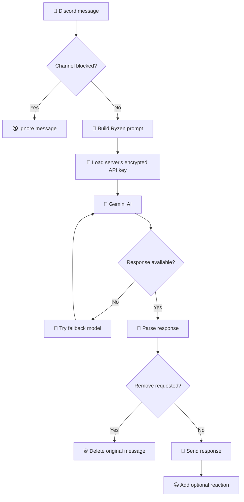

# 🐉 Ryzen — Your Server's AI Companion

<div align="center">

<!-- Animated typing title -->
<a href="https://github.com/Sunray-hub">
  
</a>

**A friendly, AI-powered Discord bot built to make your server more interactive.**

[](https://www.python.org/)
[](https://discordpy.readthedocs.io/)
[](https://ai.google.dev/)
[](https://cryptography.io/)

<br>

*Not another bot that just sits there doing nothing.*

</div>

---

## ✨ Features

- 🧠 **Gemini AI:** Generates natural, conversational responses using Google's Gemini API.
- 🐉 **Custom personality:** Ryzen is designed to be friendly, casual, and occasionally funny.
- 🔑 **Per-server API keys:** Each Discord server can configure its own Gemini API key using `/setup`.
- 🔐 **Encrypted key storage:** API keys are encrypted with Fernet before being saved.
- 🔄 **Model fallback:** Tries another configured Gemini model when certain errors occur.
- 💬 **Smart responses:** Can respond normally or reply directly to a message.
- 😀 **Emoji reactions:** Ryzen can react to messages when appropriate.
- 🛡️ **Channel controls:** Server moderators can use `/blockchannel` and `/unblockchannel`.
- ⚙️ **Slash commands:** Configuration and channel controls use Discord slash commands.
- 🖥️ **Self-hostable:** Run Ryzen on your own computer, VPS, or home server.

> **Note:** Ryzen's AI moderation instructions are not a substitute for a dedicated moderation system. Model-generated decisions can be inconsistent, so use proper Discord permissions and moderation tools for important safety rules.

---

## 🎬 How Ryzen works

<div align="center">



</div>

### The process

1. A user sends a message in a Discord server.
2. Ryzen checks whether the channel is blocked.
3. It builds a prompt containing its personality and the user's message.
4. It loads the server's encrypted Gemini API key and creates an AI request.
5. Gemini generates a response, with a fallback model available for retryable errors.
6. Ryzen parses the response into a message, optional reaction, and optional reply instruction.
7. Ryzen sends the response and attempts to add the requested reaction.

Ryzen keeps Gemini chat sessions in memory for each server while the bot process is running. **Persistent conversation history across restarts and separate per-channel memory are not implemented in this version.**

---

## 🚀 Getting started

### 1. Requirements

You will need:

- Python 3.10 or newer
- A Discord account and a Discord server where you can manage bots
- A Discord bot application
- Access to the Google Gemini API
- Git (optional, but recommended)

### 2. Clone the repository

Replace the example repository URL with the actual URL of your Ryzen repository.

```bash
git clone https://github.com/YOUR-USERNAME/YOUR-REPOSITORY.git
cd YOUR-REPOSITORY
```

### 3. Install dependencies

Create a virtual environment:

**Windows**
```powershell
py -m venv .venv
.venv\Scripts\activate
```

**Linux / Ubuntu / CasaOS**
```bash
python3 -m venv .venv
source .venv/bin/activate
```

Install the required packages:

```bash
pip install -U discord.py google-genai python-dotenv cryptography
```

### 4. Create your `.env` file

Create a file named `.env` in the same directory as `app.py`.

```dotenv
DISCORD_TOKEN=your_discord_bot_token
ENCRYPTION_KEY=your_generated_fernet_key
```

**These are the two environment variables required by the supplied code.**

| Variable | Purpose |
|---|---|
| `DISCORD_TOKEN` | Authenticates Ryzen with Discord. |
| `ENCRYPTION_KEY` | Encrypts and decrypts the Gemini API keys stored by Ryzen. |

You do **not** need to put `GEMINI_API_KEY` in `.env` for this version. Each server submits its own Gemini API key through `/setup`.

### 5. Generate your encryption key

Run this command in the same Python environment where you installed `cryptography`:

```bash
python -c "from cryptography.fernet import Fernet; print(Fernet.generate_key().decode())"
```

Copy the generated key into `.env`:

```dotenv
ENCRYPTION_KEY=paste_your_generated_key_here
```

Keep this key private. If you lose it, the previously encrypted API keys in `guild_settings.json` cannot be decrypted with the new key.

### 6. Configure your Discord bot

In the [Discord Developer Portal](https://discord.com/developers/applications):

1. Create an application and add a bot.
2. Copy its bot token into `DISCORD_TOKEN`.
3. Open **Bot → Privileged Gateway Intents**.
4. Enable **Message Content Intent**.
5. Invite the bot to your server with the permissions it needs.

Ryzen's current code uses message content to generate AI responses. It also needs permission to send messages, read message history, add reactions, and manage messages if you want its message-deletion feature to work.

Use the OAuth2 URL Generator to create an invite link with the `bot` and `applications.commands` scopes.

### 7. Start Ryzen

```bash
python app.py
```

If everything is configured correctly, you should see a login message in the console.

---

## ⚙️ Setting up Ryzen in Discord

Once Ryzen is online, a server administrator can run:

### `/setup`

Opens a private setup form where an administrator with **Manage Server** permission can enter the server's Gemini API key.

Ryzen attempts to verify the key before saving it. After successful verification, the encrypted key is saved in `guild_settings.json`.

### `/blockchannel`

Blocks Ryzen from responding in the current channel. Requires **Manage Channels** permission.

### `/unblockchannel`

Allows Ryzen to respond in the current channel again. Requires **Manage Channels** permission.

The bot needs the appropriate Discord permissions for these features to work.

---

## 🔐 Security and privacy

Ryzen is designed to store a separate Gemini API key for each Discord server.

- API keys are encrypted using Fernet.
- The encrypted keys are stored in `guild_settings.json`.
- Blocked channel IDs are stored in `blocked_channels.json`.
- The bot attempts to restrict the settings file to owner-only permissions on supported systems.
- Setup responses are ephemeral, so the submitted key isn't intentionally posted in a public channel.
- The `.env` file should never be committed to GitHub.

**Important security details:**

1. Fernet encryption is only as secure as the protection of `ENCRYPTION_KEY`. Anyone who obtains both the encryption key and settings file may be able to decrypt the stored API keys.
2. Keep your bot token, encryption key, and API keys out of source code, logs, screenshots, and public repositories.
3. The current implementation sends server messages to Google's Gemini API to generate responses. Tell your community how AI processing works and follow the applicable privacy requirements.
4. The current `/setup` flow doesn't provide an API-key replacement command. An administrator cannot configure a different key through `/setup` once one has already been saved.
5. API keys and encryption keys should be backed up securely. Losing the encryption key prevents access to the encrypted keys.

---

## 📁 Project structure

```text
ryzen/
├── app.py                  # Main Discord bot
├── .env                    # Private environment variables
├── guild_settings.json     # Per-server encrypted API keys
├── blocked_channels.json   # Blocked channel IDs
├── discord.log             # Discord logging output
├── requirements.txt        # Python dependencies
└── README.md               # Project documentation
```

Some files are created only when Ryzen runs or when the corresponding feature is used.

### Example `requirements.txt`

```text
discord.py
google-genai
python-dotenv
cryptography
```

For reproducible deployments, consider pinning dependency versions after testing them.

---

## 🧠 Gemini model configuration

The current version tries the models listed in `MODELS`:

```python
MODELS = [
    "gemini-3.5-flash-lite",
    "gemini-3.5-flash",
]
```

These are the model identifiers configured in the code, not a guarantee that the models are currently available to every API key. Verify model names, API access, and quotas using the [Gemini API documentation](https://ai.google.dev/gemini-api/docs).

When a retryable error occurs, Ryzen attempts another configured model. Errors such as invalid credentials or other non-retryable failures may stop the request rather than trigger a fallback.

---

## 🛠️ Troubleshooting

| Problem | What to check |
|---|---|
| `DISCORD_TOKEN is missing` | Make sure `.env` exists and contains `DISCORD_TOKEN`. |
| `Fernet` key error | Generate a valid Fernet key and check that it is copied correctly. |
| `/setup` fails | Check the Gemini API key, model availability, API access, and quota. |
| Ryzen ignores messages | Check Message Content Intent, blocked channels, bot permissions, and whether the server has completed setup. |
| Ryzen cannot delete messages | Give it Manage Messages permission and verify the moderation behavior. |
| Slash commands don't appear | Check the bot invite scopes and the console output from command synchronization. |
| `429` or `503` errors | Check quota, rate limits, service availability, and fallback model configuration. |
| Encrypted keys cannot be read | Restore the original `ENCRYPTION_KEY`; generating a new key will not decrypt old data. |

---

## 🗺️ Roadmap

Ideas for future Ryzen releases:

- [ ] `/setup` key replacement and removal commands
- [ ] Per-channel conversation memory
- [ ] Persistent chat history with configurable limits
- [ ] Admin dashboard for server configuration
- [ ] More robust moderation with explicit safeguards
- [ ] Additional AI provider fallbacks
- [ ] Better error reporting and structured logging
- [ ] Docker Compose deployment guide
- [ ] Automated tests and CI checks
- [ ] Usage and quota tracking for each server

---

## 🤝 Contributing

Ideas, bug reports, and improvements are welcome!

1. Fork the repository.
2. Create a feature branch.
3. Make your changes and test them.
4. Open a pull request describing the improvement.

Please never include real API keys, tokens, or private server data in issues or pull requests.

---

## 📜 License

Ryzen is open-source software licensed under the [MIT License](LICENSE).

You are free to use, copy, modify, merge, publish, distribute, sublicense, and sell copies of the software, subject to the conditions of the MIT License.

See the [`LICENSE`](LICENSE) file for the full license text.

<div align="center">

### 🐉 Ryzen — Built for communities, powered by AI.

*Made with Python, Discord.py, and Google Gemini.*

**If you like the project, consider giving the repository a ⭐**

</div>
